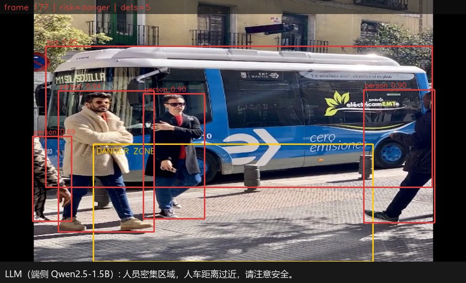

# RK3588 边缘多模态推理

视频进来，先检测人和车，再让端侧的 Qwen2.5-1.5B 说一句中文预警。检测和生成都在 Orange Pi 5 Pro 上跑，不依赖云端。



上图是 `mm_edge` 实际输出的帧：框、危险区和 risk 标记由 C++ 画；底部那句中文是 LLM 输出，因为 OpenCV 自带字体没有中文字形，配图时用 `tools/render_zh.py` 叠了一行，不参与推理。


## 能做什么

- RF-DETR-Nano 拆成两段：DINOv2 backbone 走 RKNN / NPU，Transformer 和检测头走 CPU 上的 ONNX Runtime
- 规则层判断"人员进入危险区 / 人车过近 / 人员聚集"，LLM 只负责把确定的事实讲成人话
- CV 线程和 LLM 线程异步，观测只保留最新一条，预警不会越积越旧
- RKNN 输入输出走零拷贝；`--no-zero-copy` 可以切回旧路径做 A/B

## 跑起来

x86 上导出模型：

```bash
python3 -m venv ~/venv_rfdetr && source ~/venv_rfdetr/bin/activate
pip install rfdetr onnx onnxruntime supervision
export HF_ENDPOINT=https://hf-mirror.com
python scripts/export_split_onnx.py --weights rfdetr_nano.pth --out output --skip-full

python3 -m venv ~/rknn_env && source ~/rknn_env/bin/activate
pip install rknn-toolkit2==2.3.2 "setuptools<81" "onnx==1.16.1" "numpy<2"
python scripts/convert_backbone_rknn.py --input output/backbone.onnx --output output/backbone.rknn
```

板端需要 RKNN runtime 2.3.2、ONNX Runtime C++ SDK 和 RKLLM 1.2.3：

```bash
cd cpp
cmake -B build -DCMAKE_BUILD_TYPE=Release \
  -DONNXRUNTIME_DIR=$HOME/deps/onnxruntime-linux-aarch64-1.23.2
cmake --build build -j4

./build/mm_edge \
  --video ../data/demo_scene.mp4 \
  --backbone ../models/backbone.rknn \
  --head ../models/detection.onnx \
  --llm ~/rkllm_work/model/Qwen2.5-1.5B.rkllm \
  --out ../output --stride 4 --core-mask 1 --cv-cores 0,1,2,3 --no-loop
```

单图基准：`./build/mm_edge --bench 10 --image ../data/sample.jpg ...`，`--bench-json` 落盘。

## 实测

Orange Pi 5 Pro（RK3588S，16GB），CV 绑 A55、backbone 绑 NPU core0，`sample.jpg` 跑 200 次：

| 阶段 | 原版 p50 | 零拷贝 p50 |
|---|---|---|
| Backbone（NPU） | 188.4 ms | 188.6 ms |
| Transformer + 检测头（CPU 4 线程） | 39.7 ms | 38.7 ms |
| 输入 + 输出拷贝 | 5.7 ms | 0.7 ms |
| 单帧 | 242.1 ms（p95 333.2） | **235.0 ms（p95 314.4）** |

I/O 省掉约 5ms 以后，瓶颈很清楚：backbone 占单帧的 78%，继续抠拷贝没有意义。
fp16 backbone 和 ONNX 参考的数值对齐：余弦 0.9998，相对 L2 1.9%，最大绝对误差 1.04（离群点）。

完整流水线（180 帧、45 次推理、3 次 LLM 调用）：CV 单帧 263ms、3.7 fps；
LLM 首 token p50 1.5s，端到端 p50 5.5s。LLM 波动比 CV 大，三次调用在
`assets/llm_traces_demo.jsonl`，原始 report 在 `assets/report_demo.json`。
零拷贝前后的 raw JSON 在 `assets/bench_baseline.json`、`assets/bench_zerocopy.json`。

## 目录

```
cpp/                  板端 C++ 实现
  src/                rfdetr_split / scene / llm / pipeline / main
  tests/              x86 单测（规则、Prompt、统计、JSON）
scripts/              x86 侧导出和转换；板端数值对齐脚本
assets/               实测 report、bench JSON、LLM 输出
docs/OPTIMIZATION.md  零拷贝、数值对齐和瓶颈分析
docs/NOTES.md         实现细节
```

## 限制

- 演示素材是合成的，不含真实监控画面
- 检测头是 ORT 动态量化，backbone 是 FP16，都没做 QAT；backbone INT8 还没跑
- LLM 是 Qwen2.5-1.5B 的 w8a8；w4a16 转换流程在 `docs/quantize_w4a16.md`，没有在板上跑
- 只处理一路视频，不接摄像头流，也不做多轮对话
- NPU 跑 backbone 时 CPU 跑 head，两段还没做流水线重叠

## 更多

拆分推理、线程绑核、零拷贝和数值对齐分别在 `docs/NOTES.md`、`docs/OPTIMIZATION.md`。
